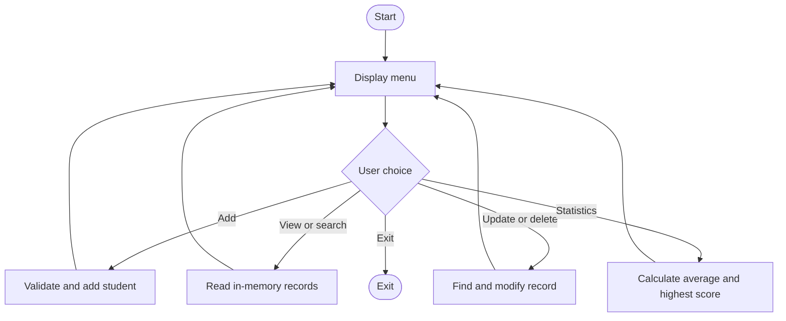

# Student Management System

A menu-driven Python CLI for managing student records and calculating basic academic statistics. This is a beginner project demonstrating Python fundamentals; it does not yet use a database or expose a REST API.

## Features

- Add, view, search, update, and delete student records
- Validate marks within the 0–100 range
- Prevent duplicate names and roll numbers (as implemented)
- Calculate average marks and identify the highest scorer

## Tech stack

Python 3 · Standard library · Command-line interface

## Run locally

```bash
git clone https://github.com/kirubanandhan016/python-student-management-system.git
cd python-student-management-system
python main.py
```

On Windows, `py main.py` can be used if the Python launcher is installed.

## How data is stored

The application keeps records in memory using Python collections. Records are lost when the program exits; persistent storage is not currently included.

## Example student record

```python
{
    "name": "Arun",
    "roll_number": "101",
    "section": "B.E. ECE",
    "marks": 85.0
}
```

## Concepts demonstrated

- Variables, collections, loops, and conditionals
- Functions and modular program flow
- CRUD operations on in-memory records
- Input validation and basic aggregation
- Git and README documentation

## Future improvements

- Persist records in SQLite or JSON
- Add tests for validation and CRUD behavior
- Handle invalid numeric input consistently
- Extend the project into a FastAPI service

## Project scope

This is a learning project, not a production student information system. The repository's code is the source of truth for implemented behavior; run it locally to verify current functionality.

## Author

**Kirubanandhan V** · [GitHub](https://github.com/kirubanandhan016) · [Portfolio](https://kirubanandhan016.github.io/) · [LinkedIn](https://www.linkedin.com/in/kirubanandhan-v-98bb83443/)


## Application flow



## Verification status

No automated test suite is currently documented in this repository. Manually verify valid and invalid marks, duplicate roll numbers, unknown student lookups, update/delete behavior, and empty-list statistics after changes.

